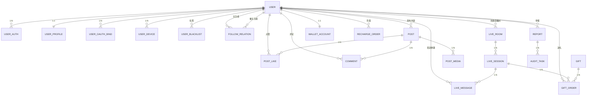

# 抖音直播风格App - 数据库表设计文档 (MVP版)

## 1. 总体架构

### 1.1 系统概述
本文档定义了抖音直播风格App（uni-app移动端 + PC后台管理 + 阿里云直播）的MySQL数据库表结构设计，支持MVP阶段所有核心功能。

### 1.2 技术选型
- **数据库版本**: MySQL 8.0+
- **字符集**: utf8mb4 (支持emoji表情)
- **排序规则**: utf8mb4_unicode_ci
- **存储引擎**: InnoDB
- **ID生成策略**: BIGINT AUTO_INCREMENT (后续可升级为雪花算法)

### 1.3 表关系图（Mermaid）



---

## 2. 用户体系模块（6张表）

### 2.1 user - 用户基本表

**用途**: 存储用户核心账号信息，作为整个系统的用户主表

| 字段名 | 类型 | 长度 | NULL | DEFAULT | 索引 | 注释 |
|--------|------|------|------|---------|------|------|
| id | BIGINT | - | NOT NULL | AUTO_INCREMENT | PRIMARY | 用户ID |
| phone | VARCHAR | 20 | NULL | NULL | idx_phone | 手机号(国际格式) |
| email | VARCHAR | 100 | NULL | NULL | idx_email | 邮箱 |
| password_hash | VARCHAR | 255 | NULL | NULL | - | 密码哈希(BCrypt) |
| nickname | VARCHAR | 32 | NOT NULL | '新用户' | - | 昵称 |
| avatar | VARCHAR | 500 | NULL | NULL | - | 头像URL |
| status | TINYINT | - | NOT NULL | 0 | idx_status | 账号状态:0=正常,1=封禁,2=注销 |
| deleted | TINYINT | - | NOT NULL | 0 | - | 软删除:0=未删,1=已删 |
| create_time | DATETIME | - | NOT NULL | CURRENT_TIMESTAMP | - | 创建时间 |
| update_time | DATETIME | - | NOT NULL | CURRENT_TIMESTAMP | - | 更新时间 |

**关键索引**:
- `PRIMARY KEY (id)`
- `UNIQUE KEY uk_phone (phone, deleted)` - 支持软删除后手机号复用
- `UNIQUE KEY uk_email (email, deleted)` - 支持软删除后邮箱复用
- `KEY idx_status (status, deleted)` - 管理员批量查询封禁用户

**设计说明**:
- phone/email允许NULL，支持第三方登录用户未绑定手机/邮箱
- password_hash允许NULL，支持纯三方登录用户
- nickname设置默认值，避免前端显示NULL
- status字段支持多状态管理，便于后台批量操作

---

### 2.2 user_auth - 多登录方式表

**用途**: 支持多种登录方式（手机验证码、邮箱验证码、密码、第三方OAuth）

| 字段名 | 类型 | 长度 | NULL | DEFAULT | 索引 | 注释 |
|--------|------|------|------|---------|------|------|
| id | BIGINT | - | NOT NULL | AUTO_INCREMENT | PRIMARY | 主键 |
| user_id | BIGINT | - | NOT NULL | - | idx_user_id | 用户ID |
| auth_type | TINYINT | - | NOT NULL | - | - | 认证类型:1=手机验证码,2=邮箱验证码,3=密码,4=第三方 |
| auth_id | VARCHAR | 100 | NOT NULL | - | - | 认证标识(手机号/邮箱/OAuth ID) |
| auth_token | VARCHAR | 500 | NULL | NULL | - | 认证令牌(OAuth Token) |
| deleted | TINYINT | - | NOT NULL | 0 | - | 软删除 |
| create_time | DATETIME | - | NOT NULL | CURRENT_TIMESTAMP | - | 创建时间 |

**关键索引**:
- `PRIMARY KEY (id)`
- `UNIQUE KEY uk_auth (auth_type, auth_id, deleted)` - 防止同一登录方式重复绑定
- `KEY idx_user_id (user_id, deleted)` - 查询用户所有登录方式

**设计说明**:
- auth_type枚举支持未来扩展更多登录方式
- auth_id存储认证标识，根据auth_type可以是手机号/邮箱/OAuth ID
- auth_token存储第三方令牌，用于刷新或撤销授权

---

### 2.3 user_profile - 用户资料扩展表

**用途**: 存储用户详细资料和个性化信息

| 字段名 | 类型 | 长度 | NULL | DEFAULT | 索引 | 注释 |
|--------|------|------|------|---------|------|------|
| id | BIGINT | - | NOT NULL | AUTO_INCREMENT | PRIMARY | 主键 |
| user_id | BIGINT | - | NOT NULL | - | UNIQUE idx_user_id | 用户ID |
| gender | TINYINT | - | NULL | 0 | - | 性别:0=未知,1=男,2=女 |
| birthday | DATE | - | NULL | NULL | - | 生日 |
| location | VARCHAR | 100 | NULL | NULL | - | 地理位置 |
| bio | VARCHAR | 255 | NULL | NULL | - | 个人简介 |
| signature | VARCHAR | 255 | NULL | NULL | - | 个性签名 |
| deleted | TINYINT | - | NOT NULL | 0 | - | 软删除 |
| create_time | DATETIME | - | NOT NULL | CURRENT_TIMESTAMP | - | 创建时间 |
| update_time | DATETIME | - | NOT NULL | CURRENT_TIMESTAMP | - | 更新时间 |

**关键索引**:
- `PRIMARY KEY (id)`
- `UNIQUE KEY uk_user_id (user_id, deleted)` - 一对一关系

**设计说明**:
- 与user表一对一，拆分减少主表字段数量
- 所有扩展字段允许NULL，支持渐进式完善资料
- signature用于直播间显示，bio用于个人主页

---

### 2.4 user_oauth_bind - 第三方绑定表

**用途**: 存储用户与第三方平台（微信、QQ、微博等）的绑定关系

| 字段名 | 类型 | 长度 | NULL | DEFAULT | 索引 | 注释 |
|--------|------|------|------|---------|------|------|
| id | BIGINT | - | NOT NULL | AUTO_INCREMENT | PRIMARY | 主键 |
| user_id | BIGINT | - | NOT NULL | - | idx_user_id | 用户ID |
| oauth_provider | VARCHAR | 20 | NOT NULL | - | - | OAuth提供商:wechat/qq/weibo/apple |
| oauth_id | VARCHAR | 100 | NOT NULL | - | - | 第三方用户ID(openid) |
| unionid | VARCHAR | 100 | NULL | NULL | - | 统一用户标识(微信unionid) |
| deleted | TINYINT | - | NOT NULL | 0 | - | 软删除 |
| create_time | DATETIME | - | NOT NULL | CURRENT_TIMESTAMP | - | 创建时间 |

**关键索引**:
- `PRIMARY KEY (id)`
- `UNIQUE KEY uk_oauth (oauth_provider, oauth_id, deleted)` - 防止同一第三方账号重复绑定
- `KEY idx_user_id (user_id, deleted)` - 查询用户所有绑定
- `KEY idx_unionid (unionid)` - 支持unionid查询（微信开放平台）

**设计说明**:
- oauth_provider使用字符串便于扩展新平台
- unionid支持微信多应用统一身份识别
- 支持一个用户绑定多个第三方平台

---

### 2.5 user_device - 设备管理表

**用途**: 记录用户登录设备信息，支持多端登录和设备管理

| 字段名 | 类型 | 长度 | NULL | DEFAULT | 索引 | 注释 |
|--------|------|------|------|---------|------|------|
| id | BIGINT | - | NOT NULL | AUTO_INCREMENT | PRIMARY | 主键 |
| user_id | BIGINT | - | NOT NULL | - | idx_user_id | 用户ID |
| device_id | VARCHAR | 100 | NOT NULL | - | - | 设备唯一标识(UDID/IMEI) |
| device_name | VARCHAR | 100 | NULL | NULL | - | 设备名称(iPhone 15 Pro) |
| os | VARCHAR | 20 | NULL | NULL | - | 操作系统:ios/android/web |
| last_login_time | DATETIME | - | NULL | NULL | - | 最后登录时间 |
| deleted | TINYINT | - | NOT NULL | 0 | - | 软删除 |
| create_time | DATETIME | - | NOT NULL | CURRENT_TIMESTAMP | - | 创建时间 |

**关键索引**:
- `PRIMARY KEY (id)`
- `UNIQUE KEY uk_device (user_id, device_id, deleted)` - 用户唯一设备
- `KEY idx_user_id (user_id, last_login_time)` - 查询用户设备列表（按最后登录排序）

**设计说明**:
- 支持用户查看/管理所有登录设备
- 可用于异地登录提醒、强制下线等安全功能
- last_login_time用于判断长期未使用设备

---

### 2.6 user_blacklist - 黑名单表

**用途**: 用户间拉黑关系，拉黑后对方无法关注、评论、送礼

| 字段名 | 类型 | 长度 | NULL | DEFAULT | 索引 | 注释 |
|--------|------|------|------|---------|------|------|
| id | BIGINT | - | NOT NULL | AUTO_INCREMENT | PRIMARY | 主键 |
| user_id | BIGINT | - | NOT NULL | - | - | 拉黑者ID |
| blocked_user_id | BIGINT | - | NOT NULL | - | - | 被拉黑用户ID |
| reason | VARCHAR | 255 | NULL | NULL | - | 拉黑原因 |
| status | TINYINT | - | NOT NULL | 1 | - | 状态:1=生效,0=已移除 |
| deleted | TINYINT | - | NOT NULL | 0 | - | 软删除 |
| create_time | DATETIME | - | NOT NULL | CURRENT_TIMESTAMP | - | 创建时间 |

**关键索引**:
- `PRIMARY KEY (id)`
- `UNIQUE KEY uk_blacklist (user_id, blocked_user_id, deleted)` - 防止重复拉黑
- `KEY idx_blocked_user_id (blocked_user_id, status)` - 判断是否被某用户拉黑

**设计说明**:
- status字段支持软移除（解除拉黑后保留历史记录）
- reason可用于用户申诉或平台审核
- 查询时需同时检查status=1和deleted=0

---

## 3. 社交关系模块（1张表）

### 3.1 follow_relation - 关注表

**用途**: 存储用户间关注关系，支持单向关注和互相关注判断

| 字段名 | 类型 | 长度 | NULL | DEFAULT | 索引 | 注释 |
|--------|------|------|------|---------|------|------|
| id | BIGINT | - | NOT NULL | AUTO_INCREMENT | PRIMARY | 主键 |
| follower_id | BIGINT | - | NOT NULL | - | - | 关注者ID |
| following_id | BIGINT | - | NOT NULL | - | - | 被关注者ID |
| mutual | TINYINT | - | NOT NULL | 0 | - | 是否互关:0=否,1=是 |
| status | TINYINT | - | NOT NULL | 1 | - | 状态:1=正常,0=已取消 |
| deleted | TINYINT | - | NOT NULL | 0 | - | 软删除 |
| create_time | DATETIME | - | NOT NULL | CURRENT_TIMESTAMP | - | 创建时间 |

**关键索引**:
- `PRIMARY KEY (id)`
- `UNIQUE KEY uk_follow_pair (follower_id, following_id, deleted)` - 防止重复关注
- `KEY idx_follower_id (follower_id, status, deleted)` - 查询我关注的人
- `KEY idx_following_id (following_id, status, deleted)` - 查询关注我的人
- `KEY idx_mutual (following_id, mutual, status, deleted)` - 查询互相关注的粉丝

**设计说明**:
- mutual字段冗余互关状态，避免双向查询
- status字段支持取消关注后保留历史记录（用于数据分析）
- 查询时必须带deleted=0和status=1条件
- 高频查询场景建议缓存到Redis（关注列表、粉丝数、关注数）

**数据量估算**:
- 预计100万用户，平均每人关注50人：5000万行
- 建议：超过1亿行后按follower_id % 10 进行分表

---

## 4. 直播模块（3张表）

### 4.1 live_room - 直播间表

**用途**: 存储直播间配置信息和推拉流地址

| 字段名 | 类型 | 长度 | NULL | DEFAULT | 索引 | 注释 |
|--------|------|------|------|---------|------|------|
| id | BIGINT | - | NOT NULL | AUTO_INCREMENT | PRIMARY | 直播间ID |
| creator_id | BIGINT | - | NOT NULL | - | idx_creator_id | 主播用户ID |
| title | VARCHAR | 100 | NOT NULL | '直播间' | - | 直播间标题 |
| description | VARCHAR | 500 | NULL | NULL | - | 直播间简介 |
| category | VARCHAR | 50 | NULL | NULL | - | 分类:才艺/聊天/游戏/户外... |
| room_status | TINYINT | - | NOT NULL | 0 | idx_room_status | 直播状态:0=待开播,1=直播中,2=已关闭 |
| visibility | TINYINT | - | NOT NULL | 0 | - | 可见性:0=公开,1=仅自己,2=好友可见,3=指定名单 |
| cover_url | VARCHAR | 500 | NULL | NULL | - | 封面图URL |
| push_url | VARCHAR | 500 | NULL | NULL | - | 推流地址(敏感) |
| play_url | VARCHAR | 500 | NULL | NULL | - | 拉流地址(HTTP-FLV/HLS) |
| stream_key | VARCHAR | 100 | NULL | NULL | - | 流密钥 |
| deleted | TINYINT | - | NOT NULL | 0 | - | 软删除 |
| create_time | DATETIME | - | NOT NULL | CURRENT_TIMESTAMP | idx_create_time | 创建时间 |
| update_time | DATETIME | - | NOT NULL | CURRENT_TIMESTAMP | - | 更新时间 |

**关键索引**:
- `PRIMARY KEY (id)`
- `KEY idx_creator_id (creator_id, deleted)` - 查询主播的直播间
- `KEY idx_room_status (room_status, visibility, deleted, create_time DESC)` - 直播广场列表查询
- `KEY idx_create_time (create_time)` - 按时间排序

**设计说明**:
- room_status与LIVE_SESSION的状态联动：开播时创建session并更新room_status=1
- visibility=3时需配合visibility_rule表（未列入MVP，可用Redis Set实现白名单）
- push_url/stream_key敏感字段，API返回时需脱敏处理
- 同一主播可创建多个直播间，但同时只能有一个处于直播中状态

**数据量估算**:
- 预计10万主播，平均每人5个直播间：50万行
- 无需分表

---

### 4.2 live_session - 直播场次表

**用途**: 记录每次直播的具体场次数据和统计信息

| 字段名 | 类型 | 长度 | NULL | DEFAULT | 索引 | 注释 |
|--------|------|------|------|---------|------|------|
| id | BIGINT | - | NOT NULL | AUTO_INCREMENT | PRIMARY | 场次ID |
| room_id | BIGINT | - | NOT NULL | - | idx_room_id | 直播间ID |
| creator_id | BIGINT | - | NOT NULL | - | idx_creator_id | 主播ID |
| start_time | DATETIME | - | NOT NULL | CURRENT_TIMESTAMP | idx_start_time | 开播时间 |
| end_time | DATETIME | - | NULL | NULL | - | 下播时间 |
| duration_sec | INT | - | NULL | 0 | - | 时长(秒) |
| peak_online | INT | - | NOT NULL | 0 | - | 峰值在线人数 |
| total_like | BIGINT | - | NOT NULL | 0 | - | 总点赞数 |
| total_gift_amount | DECIMAL | (18,2) | NOT NULL | 0.00 | - | 总礼物金额(金币) |
| status | TINYINT | - | NOT NULL | 1 | - | 状态:1=直播中,2=已结束,3=异常中断 |
| deleted | TINYINT | - | NOT NULL | 0 | - | 软删除 |
| create_time | DATETIME | - | NOT NULL | CURRENT_TIMESTAMP | - | 创建时间 |

**关键索引**:
- `PRIMARY KEY (id)`
- `KEY idx_room_id (room_id, start_time DESC)` - 查询直播间历史场次
- `KEY idx_creator_id (creator_id, start_time DESC)` - 查询主播历史场次
- `KEY idx_start_time (start_time, status)` - 按时间统计直播数据

**设计说明**:
- end_time允许NULL，直播中状态下为NULL
- duration_sec在下播时计算：end_time - start_time
- peak_online、total_like、total_gift_amount在直播过程中实时更新（使用乐观锁）
- 实时统计数据建议存入Redis，直播结束后落库

**数据量估算**:
- 预计每天5万场次直播，一年1800万行
- 建议：按start_time按月分区，超过3个月的数据归档到冷存储

---

### 4.3 live_message - 弹幕消息表

**用途**: 存储直播间弹幕消息、系统通知、礼物消息等

| 字段名 | 类型 | 长度 | NULL | DEFAULT | 索引 | 注释 |
|--------|------|------|------|---------|------|------|
| id | BIGINT | - | NOT NULL | AUTO_INCREMENT | PRIMARY | 消息ID |
| session_id | BIGINT | - | NOT NULL | - | - | 直播场次ID |
| room_id | BIGINT | - | NOT NULL | - | - | 直播间ID(冗余便于查询) |
| sender_id | BIGINT | - | NOT NULL | - | - | 发送者ID(系统消息=0) |
| message_content | VARCHAR | 500 | NOT NULL | - | - | 消息内容 |
| msg_type | TINYINT | - | NOT NULL | 1 | - | 消息类型:1=普通,2=系统,3=礼物,4=进房 |
| status | TINYINT | - | NOT NULL | 1 | - | 状态:1=正常,2=已撤回,3=违规删除 |
| deleted | TINYINT | - | NOT NULL | 0 | - | 软删除 |
| create_time | DATETIME | - | NOT NULL | CURRENT_TIMESTAMP | - | 创建时间 |

**关键索引**:
- `PRIMARY KEY (id)`
- `KEY idx_session_room_time (session_id, room_id, create_time DESC)` - 弹幕分页查询（高频查询）
- `KEY idx_sender_id (sender_id, create_time DESC)` - 查询某用户的弹幕历史

**设计说明**:
- room_id冗余是为了避免JOIN查询，提升分页查询性能
- msg_type=3时，message_content存储JSON格式：{"gift_id":1,"count":5}
- 高并发写入场景：建议先写入Redis List，异步批量落库（延迟1-2秒可接受）
- status支持撤回和违规删除，前端轮询或WebSocket推送删除事件

**数据量估算**:
- 单场直播1000条弹幕，每天5万场次：5000万行/天
- **强烈建议**：
  1. 按room_id % 10 分表（10张表）
  2. 按create_time按日分区，保留7天热数据
  3. 超过7天的弹幕归档到对象存储（OSS），仅保留索引

**性能优化**:
- 分页查询使用覆盖索引：`SELECT id, sender_id, message_content, create_time WHERE session_id=? ORDER BY create_time DESC LIMIT 20`
- 实时弹幕通过WebSocket推送，不依赖DB查询

---

## 5. 内容模块（4张表）

### 5.1 post - 内容发布表

**用途**: 存储用户发布的图文/视频内容（类似抖音的作品）

| 字段名 | 类型 | 长度 | NULL | DEFAULT | 索引 | 注释 |
|--------|------|------|------|---------|------|------|
| id | BIGINT | - | NOT NULL | AUTO_INCREMENT | PRIMARY | 内容ID |
| creator_id | BIGINT | - | NOT NULL | - | idx_creator_id | 创建者ID |
| content_text | TEXT | - | NULL | NULL | - | 内容文本描述 |
| visibility | TINYINT | - | NOT NULL | 0 | - | 可见性:0=公开,1=仅自己,2=好友可见,3=私密 |
| allow_comment | TINYINT | - | NOT NULL | 1 | - | 允许评论:0=否,1=是 |
| allow_download | TINYINT | - | NOT NULL | 0 | - | 允许下载:0=否,1=是 |
| location | VARCHAR | 100 | NULL | NULL | - | 地理位置 |
| deleted | TINYINT | - | NOT NULL | 0 | - | 软删除 |
| create_time | DATETIME | - | NOT NULL | CURRENT_TIMESTAMP | idx_create_time | 创建时间 |
| update_time | DATETIME | - | NOT NULL | CURRENT_TIMESTAMP | - | 更新时间 |

**关键索引**:
- `PRIMARY KEY (id)`
- `KEY idx_creator_id (creator_id, visibility, deleted, create_time DESC)` - 查询用户作品列表
- `KEY idx_visibility_time (visibility, deleted, create_time DESC)` - 广场/推荐流查询

**设计说明**:
- content_text使用TEXT类型支持长文本（最多65535字节）
- visibility与live_room一致，方便统一权限验证逻辑
- allow_download控制是否允许保存到本地（视频防盗）
- 点赞数、评论数等统计字段建议缓存到Redis，不冗余到DB（实时性要求高）

**数据量估算**:
- 预计100万用户，日均发布10万条内容，一年3650万行
- 无需分表，按create_time建立索引即可

---

### 5.2 post_media - 内容媒体表

**用途**: 存储内容的图片/视频素材URL

| 字段名 | 类型 | 长度 | NULL | DEFAULT | 索引 | 注释 |
|--------|------|------|------|---------|------|------|
| id | BIGINT | - | NOT NULL | AUTO_INCREMENT | PRIMARY | 主键 |
| post_id | BIGINT | - | NOT NULL | - | idx_post_id | 内容ID |
| media_type | TINYINT | - | NOT NULL | - | - | 媒体类型:1=图片,2=视频 |
| media_url | VARCHAR | 500 | NOT NULL | - | - | 媒体文件URL(OSS) |
| duration_sec | INT | - | NULL | NULL | - | 视频时长(秒) |
| deleted | TINYINT | - | NOT NULL | 0 | - | 软删除 |
| create_time | DATETIME | - | NOT NULL | CURRENT_TIMESTAMP | - | 创建时间 |

**关键索引**:
- `PRIMARY KEY (id)`
- `KEY idx_post_id (post_id, deleted)` - 查询内容的所有媒体文件

**设计说明**:
- 支持一条内容包含多个图片或一个视频
- duration_sec仅视频类型需要，图片为NULL
- media_url存储CDN地址，不存储原始文件
- 前端上传流程：前端 -> OSS直传 -> 回调后端 -> 创建post和post_media记录

---

### 5.3 post_like - 点赞表

**用途**: 记录用户对内容的点赞关系

| 字段名 | 类型 | 长度 | NULL | DEFAULT | 索引 | 注释 |
|--------|------|------|------|---------|------|------|
| id | BIGINT | - | NOT NULL | AUTO_INCREMENT | PRIMARY | 主键 |
| post_id | BIGINT | - | NOT NULL | - | - | 内容ID |
| liker_id | BIGINT | - | NOT NULL | - | - | 点赞者ID |
| deleted | TINYINT | - | NOT NULL | 0 | - | 软删除 |
| create_time | DATETIME | - | NOT NULL | CURRENT_TIMESTAMP | - | 创建时间 |

**关键索引**:
- `PRIMARY KEY (id)`
- `UNIQUE KEY uk_post_like (post_id, liker_id, deleted)` - 防止重复点赞
- `KEY idx_liker_id (liker_id, deleted, create_time DESC)` - 查询用户点赞历史

**设计说明**:
- 取消点赞逻辑：删除记录或更新deleted=1（建议删除，节省存储）
- 点赞数统计：`SELECT COUNT(*) FROM post_like WHERE post_id=? AND deleted=0`
- **性能优化**：点赞数缓存到Redis，定时写回DB（每分钟一次）

**数据量估算**:
- 每条内容平均1000个赞，一年3650万条内容 -> 365亿行
- **强烈建议**：
  1. 按post_id % 10 分表
  2. 只保留最近30天点赞记录，历史数据归档（仅保留总数）

---

### 5.4 comment - 评论表

**用途**: 存储内容的评论和回复

| 字段名 | 类型 | 长度 | NULL | DEFAULT | 索引 | 注释 |
|--------|------|------|------|---------|------|------|
| id | BIGINT | - | NOT NULL | AUTO_INCREMENT | PRIMARY | 评论ID |
| post_id | BIGINT | - | NOT NULL | - | idx_post_id | 内容ID |
| commenter_id | BIGINT | - | NOT NULL | - | idx_commenter_id | 评论者ID |
| parent_id | BIGINT | - | NULL | 0 | - | 父评论ID(0=一级评论) |
| reply_to_id | BIGINT | - | NULL | 0 | - | 回复的用户ID |
| comment_text | VARCHAR | 500 | NOT NULL | - | - | 评论内容 |
| deleted | TINYINT | - | NOT NULL | 0 | - | 软删除 |
| create_time | DATETIME | - | NOT NULL | CURRENT_TIMESTAMP | - | 创建时间 |
| update_time | DATETIME | - | NOT NULL | CURRENT_TIMESTAMP | - | 更新时间 |

**关键索引**:
- `PRIMARY KEY (id)`
- `KEY idx_post_id (post_id, parent_id, deleted, create_time DESC)` - 查询内容的评论列表
- `KEY idx_commenter_id (commenter_id, deleted, create_time DESC)` - 查询用户评论历史

**设计说明**:
- parent_id=0表示一级评论，>0表示回复某条评论
- reply_to_id记录@的用户，用于通知
- 支持编辑：更新comment_text和update_time
- 点赞数等统计字段同样建议缓存到Redis

**数据量估算**:
- 每条内容平均50条评论，一年18亿行
- 建议：按post_id % 5 分表

---

## 6. 礼物与钱包模块（4张表）

### 6.1 gift - 礼物商品表

**用途**: 存储礼物商品信息和价格配置

| 字段名 | 类型 | 长度 | NULL | DEFAULT | 索引 | 注释 |
|--------|------|------|------|---------|------|------|
| id | BIGINT | - | NOT NULL | AUTO_INCREMENT | PRIMARY | 礼物ID |
| gift_name | VARCHAR | 50 | NOT NULL | - | - | 礼物名称 |
| gift_icon_url | VARCHAR | 500 | NOT NULL | - | - | 礼物图标URL |
| coin_price | INT | - | NOT NULL | - | - | 金币价格 |
| combo_multiplier | DECIMAL | (3,2) | NOT NULL | 1.00 | - | 连击倍数(1.00-9.99) |
| special_effect_url | VARCHAR | 500 | NULL | NULL | - | 特效动画URL(Lottie/MP4) |
| status | TINYINT | - | NOT NULL | 1 | idx_status | 状态:1=上架,0=下架 |
| rank | INT | - | NOT NULL | 0 | - | 排序值(越大越靠前) |
| deleted | TINYINT | - | NOT NULL | 0 | - | 软删除 |
| create_time | DATETIME | - | NOT NULL | CURRENT_TIMESTAMP | - | 创建时间 |
| update_time | DATETIME | - | NOT NULL | CURRENT_TIMESTAMP | - | 更新时间 |

**关键索引**:
- `PRIMARY KEY (id)`
- `KEY idx_status_rank (status, deleted, rank DESC)` - 礼物列表查询（按排序值倒序）

**设计说明**:
- coin_price使用INT避免浮点数精度问题（1金币=0.01元）
- combo_multiplier支持连击玩法（快速点击送礼触发倍数）
- special_effect_url为NULL表示普通礼物，否则为全屏特效礼物
- rank字段由运营配置，控制礼物列表展示顺序

**初始化数据示例**:
```sql
INSERT INTO gift (gift_name, gift_icon_url, coin_price, combo_multiplier, rank) VALUES
('玫瑰', 'https://cdn.example.com/gift/rose.png', 1, 1.00, 100),
('棒棒糖', 'https://cdn.example.com/gift/lollipop.png', 5, 1.20, 90),
('巧克力', 'https://cdn.example.com/gift/chocolate.png', 10, 1.50, 80),
('跑车', 'https://cdn.example.com/gift/car.mp4', 1000, 5.00, 10);
```

---

### 6.2 gift_order - 礼物订单表

**用途**: 记录用户送礼流水和分成结算依据

| 字段名 | 类型 | 长度 | NULL | DEFAULT | 索引 | 注释 |
|--------|------|------|------|---------|------|------|
| id | BIGINT | - | NOT NULL | AUTO_INCREMENT | PRIMARY | 订单ID |
| session_id | BIGINT | - | NOT NULL | - | idx_session_id | 直播场次ID |
| room_id | BIGINT | - | NOT NULL | - | - | 直播间ID(冗余) |
| sender_id | BIGINT | - | NOT NULL | - | idx_sender_id | 送礼者ID |
| receiver_id | BIGINT | - | NOT NULL | - | idx_receiver_id | 主播ID |
| gift_id | BIGINT | - | NOT NULL | - | - | 礼物ID |
| amount | INT | - | NOT NULL | - | - | 金币数量 |
| combo_count | INT | - | NOT NULL | 1 | - | 连击次数 |
| order_no | VARCHAR | 64 | NOT NULL | - | UNIQUE uk_order_no | 订单号(唯一) |
| status | TINYINT | - | NOT NULL | 1 | - | 状态:0=待确认,1=已确认,2=已取消 |
| deleted | TINYINT | - | NOT NULL | 0 | - | 软删除 |
| create_time | DATETIME | - | NOT NULL | CURRENT_TIMESTAMP | - | 创建时间 |

**关键索引**:
- `PRIMARY KEY (id)`
- `UNIQUE KEY uk_order_no (order_no)` - 防止重复扣费（幂等性保证）
- `KEY idx_session_id (session_id, create_time DESC)` - 查询单场直播礼物流水
- `KEY idx_sender_id (sender_id, create_time DESC)` - 查询用户送礼历史
- `KEY idx_receiver_id (receiver_id, create_time DESC)` - 查询主播收礼统计

**设计说明**:
- order_no格式：`GIFT-{timestamp}-{user_id}-{random}` 确保唯一性
- amount = gift.coin_price * combo_count * combo_multiplier
- 扣费流程：
  1. 前端请求送礼（带order_no）
  2. 后端检查order_no是否已存在（幂等）
  3. 扣除sender钱包余额（事务+乐观锁）
  4. 创建gift_order记录（status=1）
  5. 增加receiver钱包余额（分成比例如50%）
- status=2用于异常回滚场景

**数据量估算**:
- 单场直播平均500个礼物，每天5万场次：2500万行/天
- 建议：按create_time按月分区

---

### 6.3 wallet_account - 钱包表

**用途**: 存储用户虚拟币余额和统计信息

| 字段名 | 类型 | 长度 | NULL | DEFAULT | 索引 | 注释 |
|--------|------|------|------|---------|------|------|
| id | BIGINT | - | NOT NULL | AUTO_INCREMENT | PRIMARY | 主键 |
| user_id | BIGINT | - | NOT NULL | - | UNIQUE uk_user_id | 用户ID |
| balance | BIGINT | - | NOT NULL | 0 | - | 可用余额(金币) |
| frozen_amount | BIGINT | - | NOT NULL | 0 | - | 冻结金额(金币) |
| total_recharge | BIGINT | - | NOT NULL | 0 | - | 累计充值(金币) |
| total_consume | BIGINT | - | NOT NULL | 0 | - | 累计消费(金币) |
| version | INT | - | NOT NULL | 0 | - | 版本号(乐观锁) |
| deleted | TINYINT | - | NOT NULL | 0 | - | 软删除 |
| create_time | DATETIME | - | NOT NULL | CURRENT_TIMESTAMP | - | 创建时间 |
| update_time | DATETIME | - | NOT NULL | CURRENT_TIMESTAMP | - | 更新时间 |

**关键索引**:
- `PRIMARY KEY (id)`
- `UNIQUE KEY uk_user_id (user_id, deleted)` - 用户唯一钱包

**设计说明**:
- 金额使用BIGINT存储最小单位(金币)，避免浮点数精度问题
- frozen_amount用于冻结资金（如提现审核中）
- version字段实现乐观锁，防止并发扣款问题：
  ```sql
  UPDATE wallet_account 
  SET balance = balance - ?, 
      total_consume = total_consume + ?,
      version = version + 1
  WHERE user_id = ? AND version = ? AND balance >= ?
  ```
- total_recharge/total_consume用于RFM分析和用户分层

---

### 6.4 recharge_order - 充值订单表

**用途**: 记录用户充值流水和支付渠道

| 字段名 | 类型 | 长度 | NULL | DEFAULT | 索引 | 注释 |
|--------|------|------|------|---------|------|------|
| id | BIGINT | - | NOT NULL | AUTO_INCREMENT | PRIMARY | 订单ID |
| user_id | BIGINT | - | NOT NULL | - | idx_user_id | 用户ID |
| amount | DECIMAL | (10,2) | NOT NULL | - | - | 充值金额(人民币元) |
| coin_amount | BIGINT | - | NOT NULL | - | - | 赠送金币数量 |
| payment_channel | TINYINT | - | NOT NULL | - | - | 支付渠道:1=支付宝,2=微信,3=苹果IAP |
| pay_order_id | VARCHAR | 64 | NULL | NULL | - | 第三方支付订单号 |
| order_no | VARCHAR | 64 | NOT NULL | - | UNIQUE uk_order_no | 订单号(唯一) |
| status | TINYINT | - | NOT NULL | 0 | idx_status | 状态:0=待支付,1=已支付,2=已确认,3=已关闭 |
| deleted | TINYINT | - | NOT NULL | 0 | - | 软删除 |
| create_time | DATETIME | - | NOT NULL | CURRENT_TIMESTAMP | - | 创建时间 |
| update_time | DATETIME | - | NOT NULL | CURRENT_TIMESTAMP | - | 更新时间 |

**关键索引**:
- `PRIMARY KEY (id)`
- `UNIQUE KEY uk_order_no (order_no)` - 订单号唯一
- `KEY idx_user_id (user_id, create_time DESC)` - 查询用户充值历史
- `KEY idx_status (status, create_time)` - 查询待处理订单

**设计说明**:
- order_no格式：`RCH-{timestamp}-{user_id}-{random}`
- amount精度DECIMAL(10,2)支持最大9999万元充值
- coin_amount支持充值赠送（如充100元送10元）
- 充值流程：
  1. 创建订单（status=0）
  2. 调起支付SDK
  3. 支付成功回调（status=1，记录pay_order_id）
  4. 增加钱包余额（status=2）
- status=3用于超时关闭（如30分钟未支付）

---

## 7. 审核与举报模块（2张表）

### 7.1 report - 举报表

**用途**: 存储用户举报记录和处理状态

| 字段名 | 类型 | 长度 | NULL | DEFAULT | 索引 | 注释 |
|--------|------|------|------|---------|------|------|
| id | BIGINT | - | NOT NULL | AUTO_INCREMENT | PRIMARY | 举报ID |
| reporter_id | BIGINT | - | NOT NULL | - | idx_reporter_id | 举报人ID |
| report_type | TINYINT | - | NOT NULL | - | idx_report_type | 举报类型:1=涉黄,2=涉政,3=广告,4=辱骂,5=诈骗,6=侵权,7=其他 |
| target_type | TINYINT | - | NOT NULL | - | - | 目标类型:1=用户,2=直播间,3=内容,4=评论 |
| target_id | BIGINT | - | NOT NULL | - | idx_target | 目标ID |
| reason | VARCHAR | 500 | NULL | NULL | - | 举报原因 |
| evidence_url | VARCHAR | 1000 | NULL | NULL | - | 证据截图URL(多个用逗号分隔) |
| status | TINYINT | - | NOT NULL | 0 | idx_status | 状态:0=待审核,1=已通过,2=已驳回,3=已处罚 |
| handled_by | BIGINT | - | NULL | NULL | - | 处理人ID(审核员) |
| result | VARCHAR | 500 | NULL | NULL | - | 处理结果说明 |
| deleted | TINYINT | - | NOT NULL | 0 | - | 软删除 |
| create_time | DATETIME | - | NOT NULL | CURRENT_TIMESTAMP | idx_create_time | 创建时间 |
| update_time | DATETIME | - | NOT NULL | CURRENT_TIMESTAMP | - | 更新时间 |

**关键索引**:
- `PRIMARY KEY (id)`
- `KEY idx_reporter_id (reporter_id, create_time DESC)` - 查询用户举报历史
- `KEY idx_report_type (report_type, status, deleted)` - 按类型统计待审核数量
- `KEY idx_target (target_type, target_id, deleted)` - 查询某对象被举报次数
- `KEY idx_status_time (status, create_time)` - 审核工作台列表查询
- `KEY idx_create_time (create_time)` - 时间范围统计

**设计说明**:
- report_type枚举覆盖常见违规类型，可扩展
- target_type+target_id组合定位被举报对象
- evidence_url存储多个截图URL（前端限制最多3张）
- status流转：0->1(通过但不处罚) / 0->2(驳回) / 0->3(通过并处罚)
- handled_by记录审核员，便于审核质量追溯

**数据量估算**:
- 预计每天1000条举报，一年36万行
- 无需分表

---

### 7.2 audit_task - 审核工单表

**用途**: 记录审核操作详情和处罚措施

| 字段名 | 类型 | 长度 | NULL | DEFAULT | 索引 | 注释 |
|--------|------|------|------|---------|------|------|
| id | BIGINT | - | NOT NULL | AUTO_INCREMENT | PRIMARY | 工单ID |
| report_id | BIGINT | - | NOT NULL | - | idx_report_id | 举报ID |
| auditor_id | BIGINT | - | NOT NULL | - | idx_auditor_id | 审核员ID |
| audit_time | DATETIME | - | NOT NULL | CURRENT_TIMESTAMP | - | 审核时间 |
| result | TINYINT | - | NOT NULL | - | - | 审核结果:1=通过,2=驳回 |
| reason | VARCHAR | 500 | NULL | NULL | - | 审核理由 |
| punishment | TINYINT | - | NOT NULL | 0 | - | 处罚措施:0=无,1=删除,2=禁言7天,3=封禁账号,4=限流 |
| deleted | TINYINT | - | NOT NULL | 0 | - | 软删除 |
| create_time | DATETIME | - | NOT NULL | CURRENT_TIMESTAMP | - | 创建时间 |

**关键索引**:
- `PRIMARY KEY (id)`
- `KEY idx_report_id (report_id, deleted)` - 查询举报的审核历史
- `KEY idx_auditor_id (auditor_id, audit_time DESC)` - 统计审核员工作量

**设计说明**:
- 一条举报可能经过多次审核（如一审、二审）
- punishment枚举定义具体处罚，执行时需要：
  - 1=删除：更新target表的deleted=1
  - 2=禁言：创建禁言记录（需额外设计user_mute表，本MVP未列出）
  - 3=封禁：更新user.status=1
  - 4=限流：设置推荐权重（需推荐系统支持）
- reason记录人工审核依据，用于申诉复审

---

## 8. 配置与日志模块（2张表）

### 8.1 sensitive_word - 敏感词表

**用途**: 存储敏感词库，用于弹幕、评论、昵称审核

| 字段名 | 类型 | 长度 | NULL | DEFAULT | 索引 | 注释 |
|--------|------|------|------|---------|------|------|
| id | BIGINT | - | NOT NULL | AUTO_INCREMENT | PRIMARY | 主键 |
| word | VARCHAR | 50 | NOT NULL | - | UNIQUE uk_word | 敏感词 |
| category | VARCHAR | 20 | NOT NULL | - | idx_category | 分类:politics/porn/abuse/ad/fraud |
| status | TINYINT | - | NOT NULL | 1 | - | 状态:1=启用,0=禁用 |
| deleted | TINYINT | - | NOT NULL | 0 | - | 软删除 |
| create_time | DATETIME | - | NOT NULL | CURRENT_TIMESTAMP | - | 创建时间 |

**关键索引**:
- `PRIMARY KEY (id)`
- `UNIQUE KEY uk_word (word, deleted)` - 防止重复添加
- `KEY idx_category (category, status, deleted)` - 按分类查询敏感词

**设计说明**:
- word字段区分大小写，前端输入需转小写后匹配
- category分类便于按场景过滤（如昵称只过滤politics/porn，评论过滤全部）
- 敏感词检测建议：
  1. 启动时加载全量词库到内存（Trie树/DFA算法）
  2. 检测命中后替换为***或拦截发送
  3. Redis缓存词库，定时同步DB更新

**初始化数据示例**:
```sql
INSERT INTO sensitive_word (word, category) VALUES
('习近平', 'politics'),
('色情', 'porn'),
('傻逼', 'abuse'),
('微信号', 'ad'),
('贷款', 'fraud');
```

---

### 8.2 operation_log - 操作日志表

**用途**: 记录后台管理员操作日志，用于审计和溯源

| 字段名 | 类型 | 长度 | NULL | DEFAULT | 索引 | 注释 |
|--------|------|------|------|---------|------|------|
| id | BIGINT | - | NOT NULL | AUTO_INCREMENT | PRIMARY | 日志ID |
| operator_id | BIGINT | - | NOT NULL | - | idx_operator_id | 操作人ID |
| operation_type | VARCHAR | 50 | NOT NULL | - | idx_operation_type | 操作类型:CREATE/UPDATE/DELETE/LOGIN/EXPORT |
| table_name | VARCHAR | 50 | NULL | NULL | - | 操作表名 |
| target_id | BIGINT | - | NULL | NULL | - | 目标记录ID |
| old_data | TEXT | - | NULL | NULL | - | 修改前数据(JSON) |
| new_data | TEXT | - | NULL | NULL | - | 修改后数据(JSON) |
| ip | VARCHAR | 50 | NULL | NULL | - | 操作IP |
| deleted | TINYINT | - | NOT NULL | 0 | - | 软删除 |
| create_time | DATETIME | - | NOT NULL | CURRENT_TIMESTAMP | idx_create_time | 创建时间 |

**关键索引**:
- `PRIMARY KEY (id)`
- `KEY idx_operator_id (operator_id, create_time DESC)` - 查询某人操作历史
- `KEY idx_operation_type (operation_type, create_time DESC)` - 按操作类型统计
- `KEY idx_create_time (create_time)` - 按时间范围查询

**设计说明**:
- operation_type枚举常见操作类型，可扩展
- old_data/new_data存储JSON格式，记录修改前后完整数据
- table_name+target_id定位具体记录
- 敏感操作必须记录：用户封禁、内容删除、礼物配置修改、敏感词管理

**数据量估算**:
- 预计每天1000条日志，一年36万行
- 建议：按create_time按季度分区，超过1年的数据归档

---

## 9. 通用设计规范

### 9.1 字段命名规范
- **风格**: 统一使用蛇形命名法 `snake_case`
- **主键**: 统一使用 `id BIGINT AUTO_INCREMENT`
- **外键**: 统一使用 `{table}_id` 格式（如user_id、post_id）
- **时间字段**: 统一使用 `{action}_time` 格式（如create_time、update_time）
- **状态字段**: 统一使用 `status` TINYINT，枚举值在注释中说明
- **软删除**: 统一使用 `deleted` TINYINT (0=未删除, 1=已删除)

### 9.2 数据类型选择原则
| 数据类型 | 使用场景 | 示例 |
|----------|---------|------|
| TINYINT | 枚举值、开关、状态 | status, deleted, gender |
| INT | 数量、计数、秒级时间 | duration_sec, peak_online |
| BIGINT | ID、大数值、金币 | id, user_id, balance |
| DECIMAL(M,D) | 金额(元) | amount DECIMAL(10,2) |
| VARCHAR(N) | 短字符串 | phone(20), nickname(32), email(100) |
| TEXT | 长文本 | content_text, reason |
| DATETIME | 日期时间 | create_time, update_time |

### 9.3 索引设计原则
1. **主键索引**: 所有表必须有自增主键
2. **唯一索引**: 防止业务逻辑重复（如订单号、关注对、手机号）
3. **普通索引**: 高频查询字段（外键、状态、时间）
4. **复合索引**: 遵循最左前缀原则，顺序：等值查询 > 范围查询 > 排序字段
5. **覆盖索引**: 高频查询尽量使用覆盖索引，避免回表

**复合索引示例**:
```sql
-- ❌ 错误：排序字段在前
KEY idx_wrong (create_time, status, user_id)

-- ✅ 正确：等值查询在前
KEY idx_correct (user_id, status, create_time DESC)
```

### 9.4 软删除查询规范
所有带deleted字段的表，查询时必须加上 `WHERE deleted = 0` 条件：

```sql
-- ✅ 正确
SELECT * FROM user WHERE id = ? AND deleted = 0;

-- ❌ 错误：忘记deleted条件，可能查到已删除数据
SELECT * FROM user WHERE id = ?;
```

**MyBatis示例**:
```xml
<select id="selectById" resultType="User">
    SELECT * FROM user 
    WHERE id = #{id} AND deleted = 0
</select>
```

### 9.5 时间字段规范
- **创建时间**: `create_time DATETIME NOT NULL DEFAULT CURRENT_TIMESTAMP`
- **更新时间**: `update_time DATETIME NOT NULL DEFAULT CURRENT_TIMESTAMP ON UPDATE CURRENT_TIMESTAMP`
- **业务时间**: 根据业务定义（如start_time、end_time、last_login_time）

**注意事项**:
- MySQL 8.0+ 默认支持 DATETIME(0) 精确到秒
- 不使用TIMESTAMP（范围限制：1970-2038）
- 不使用INT存储时间戳（可读性差）

---

## 10. 性能优化建议

### 10.1 分表分区策略

| 表名 | 预估数据量 | 分表策略 | 分区策略 |
|------|-----------|----------|----------|
| user | 1000万 | 无需分表 | 无需分区 |
| follow_relation | 5000万 | 按follower_id % 10 | 无需分区 |
| live_message | 50亿/年 | 按room_id % 10 | 按日分区，保留7天 |
| post_like | 365亿/年 | 按post_id % 10 | 保留30天，历史归档 |
| comment | 18亿/年 | 按post_id % 5 | 无需分区 |
| gift_order | 9亿/年 | 无需分表 | 按月分区 |
| live_session | 1800万/年 | 无需分表 | 按月分区 |

**分区示例（live_session按月分区）**:
```sql
CREATE TABLE live_session (
    ...
) PARTITION BY RANGE (TO_DAYS(start_time)) (
    PARTITION p202401 VALUES LESS THAN (TO_DAYS('2024-02-01')),
    PARTITION p202402 VALUES LESS THAN (TO_DAYS('2024-03-01')),
    ...
);
```

### 10.2 Redis缓存策略

| 数据类型 | 缓存键 | 数据结构 | 过期时间 | 写回策略 |
|---------|--------|---------|---------|---------|
| 用户信息 | `user:{user_id}` | Hash | 1小时 | 写时更新 |
| 关注数/粉丝数 | `user:{user_id}:stat` | Hash | 10分钟 | 定时写回 |
| 直播间在线人数 | `room:{room_id}:online` | Set | 5分钟 | 实时更新 |
| 礼物排行榜 | `gift:rank:{session_id}` | ZSet | 1小时 | 定时写回 |
| 点赞数 | `post:{post_id}:like` | String | 10分钟 | 定时写回 |
| 评论数 | `post:{post_id}:comment` | String | 10分钟 | 定时写回 |
| 敏感词库 | `sensitive:words` | Set | 永久 | 实时更新 |

**缓存更新策略**:
- **实时写入类**: 直播在线人数、礼物订单 -> Redis写入后MQ异步落库
- **定时写回类**: 点赞数、评论数 -> 每分钟定时任务写回DB
- **缓存更新类**: 用户信息 -> 更新DB时同步更新Redis

### 10.3 慢查询优化

**高频查询场景**:
1. **直播广场列表**: 
   ```sql
   SELECT id, title, creator_id, cover_url 
   FROM live_room 
   WHERE room_status = 1 AND visibility = 0 AND deleted = 0
   ORDER BY create_time DESC 
   LIMIT 20;
   ```
   - 索引: `idx_room_status (room_status, visibility, deleted, create_time DESC)`
   - 优化: 热门直播间列表缓存到Redis ZSet，按create_time排序

2. **用户作品列表**:
   ```sql
   SELECT id, content_text, create_time 
   FROM post 
   WHERE creator_id = ? AND deleted = 0
   ORDER BY create_time DESC 
   LIMIT 20;
   ```
   - 索引: `idx_creator_id (creator_id, deleted, create_time DESC)`
   - 优化: 覆盖索引避免回表

3. **弹幕分页查询**:
   ```sql
   SELECT id, sender_id, message_content, create_time 
   FROM live_message 
   WHERE session_id = ? AND deleted = 0
   ORDER BY create_time DESC 
   LIMIT 20 OFFSET 100;
   ```
   - 索引: `idx_session_room_time (session_id, room_id, create_time DESC)`
   - 优化: 深分页使用id游标代替OFFSET

---

## 11. 数据安全与隐私

### 11.1 敏感数据处理
| 字段 | 脱敏规则 | 存储方式 |
|------|---------|---------|
| password_hash | API不返回 | BCrypt哈希 |
| phone | 中间4位*号 | 明文存储 |
| email | @前保留3位 | 明文存储 |
| push_url | API仅返回给主播 | 明文存储 |
| stream_key | API仅返回给主播 | 明文存储 |

### 11.2 权限验证
- **直播间visibility验证**: 拉流前检查用户是否有权限观看
- **内容visibility验证**: 接口返回前检查是否为作者/好友/公开
- **钱包操作**: 扣费前必须验证余额和乐观锁version
- **礼物订单**: 检查order_no唯一性，防止重复扣费

### 11.3 GDPR合规
- **数据导出**: 提供用户数据导出API（所有user相关表）
- **数据删除**: 用户注销时，执行以下操作：
  1. user.deleted = 1, user.status = 2
  2. 关联表软删除（user_profile, user_auth, follow_relation）
  3. 内容表匿名化（post.creator_id = 0）
  4. 钱包清零并记录日志

---

## 12. 后续扩展预留

### 12.1 MVP后待设计表
- `user_mute` - 禁言记录表（记录禁言时长和解禁时间）
- `visibility_rule` - 可见性白名单表（支持直播间/内容的指定用户可见）
- `push_notification` - 推送通知表（关注主播开播提醒）
- `withdrawal_order` - 提现订单表（主播提现流水）
- `tag` - 标签表（内容/直播间标签）
- `hot_search` - 热搜榜表（实时热搜词）
- `gift_combo_record` - 礼物连击记录表（记录连击动画触发）

### 12.2 分库分表准备
- **用户库**: user、user_profile、user_auth、wallet_account
- **社交库**: follow_relation、user_blacklist
- **内容库**: post、post_media、post_like、comment
- **直播库**: live_room、live_session、live_message
- **交易库**: gift、gift_order、recharge_order
- **审核库**: report、audit_task、sensitive_word、operation_log

### 12.3 数据归档策略
| 表名 | 归档周期 | 归档目标 |
|------|---------|---------|
| live_message | 7天 | 对象存储OSS |
| post_like | 30天 | 归档库 |
| gift_order | 3个月 | 归档库 |
| live_session | 6个月 | 归档库 |
| operation_log | 1年 | 归档库 |

---

## 13. 验证清单

- [x] 所有表字段命名遵循蛇形snake_case
- [x] 所有数值类型选用恰当范围(TINYINT/INT/BIGINT/DECIMAL)
- [x] 时间字段统一使用DATETIME，MySQL8.x默认精度
- [x] 字符串字段VARCHAR长度合理(phone=20, email=100, nickname=32)
- [x] 外键关系清晰(user_id FK to user.id等，MVP不强制外键约束)
- [x] 复合索引顺序符合最左前缀原则
- [x] 软删除查询规范：WHERE deleted = 0 AND ... (已文档说明)
- [x] SQL脚本可直接在MySQL 8.0+执行，无语法错误

---

## 14. 交付物使用指南

### 14.1 快速部署
```bash
# 1. 创建数据库
mysql -u root -p -e "CREATE DATABASE douyin_live CHARACTER SET utf8mb4 COLLATE utf8mb4_unicode_ci;"

# 2. 执行初始化脚本
mysql -u root -p douyin_live < db/初始化脚本.sql

# 3. 验证表结构
mysql -u root -p douyin_live -e "SHOW TABLES;"
```

### 14.2 后端集成（MyBatis）
```bash
# 使用MyBatis Generator生成代码
cd we-code-generator
# 配置generatorConfig.xml后执行
mvn mybatis-generator:generate
```

### 14.3 后台前端集成
- 根据表设计文档的字段清单定义TypeScript Interface
- 参考status、visibility等枚举值定义前端字典
- 表格模型的排序字段对应数据库索引字段

---

## 附录A：表清单速查

| 模块 | 表名 | 用途 | 预估数据量 |
|------|------|------|-----------|
| 用户体系 | user | 用户基本信息 | 1000万 |
| 用户体系 | user_auth | 多登录方式 | 2000万 |
| 用户体系 | user_profile | 用户资料扩展 | 1000万 |
| 用户体系 | user_oauth_bind | 第三方绑定 | 1500万 |
| 用户体系 | user_device | 设备管理 | 3000万 |
| 用户体系 | user_blacklist | 黑名单 | 100万 |
| 社交关系 | follow_relation | 关注关系 | 5000万 |
| 直播 | live_room | 直播间 | 50万 |
| 直播 | live_session | 直播场次 | 1800万/年 |
| 直播 | live_message | 弹幕消息 | 50亿/年 |
| 内容 | post | 内容发布 | 3650万/年 |
| 内容 | post_media | 内容媒体 | 5000万/年 |
| 内容 | post_like | 点赞 | 365亿/年 |
| 内容 | comment | 评论 | 18亿/年 |
| 礼物钱包 | gift | 礼物商品 | 100 |
| 礼物钱包 | gift_order | 礼物订单 | 9亿/年 |
| 礼物钱包 | wallet_account | 钱包账户 | 1000万 |
| 礼物钱包 | recharge_order | 充值订单 | 1000万/年 |
| 审核举报 | report | 举报记录 | 36万/年 |
| 审核举报 | audit_task | 审核工单 | 40万/年 |
| 配置日志 | sensitive_word | 敏感词库 | 1万 |
| 配置日志 | operation_log | 操作日志 | 36万/年 |

**总计**: 22张表

---

## 附录B：性能指标（SLA）

| 查询场景 | 目标耗时 | 实现方式 |
|---------|---------|---------|
| 用户信息查询 | < 10ms | Redis缓存 + 主键索引 |
| 直播广场列表 | < 50ms | 复合索引 + Redis缓存 |
| 弹幕分页查询 | < 100ms | 复合索引 + 分表 + 限制查询范围 |
| 关注列表查询 | < 50ms | 复合索引 + Redis缓存 |
| 礼物排行榜 | < 50ms | Redis ZSet |
| 内容推荐流 | < 100ms | 复合索引 + 推荐系统缓存 |
| 钱包余额查询 | < 10ms | Redis缓存 |
| 举报审核列表 | < 100ms | 复合索引 |

---

**文档版本**: v1.0.0  
**最后更新**: 2024-01-15  
**维护人**: CTO.NEW AI Assistant  
**适用系统**: 抖音直播风格App（MVP版）
